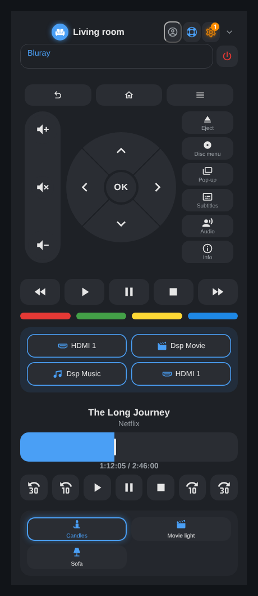
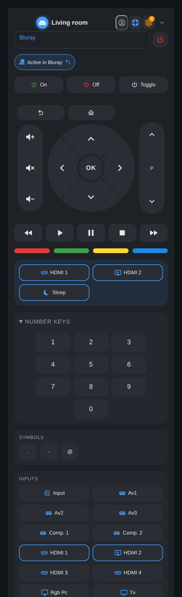
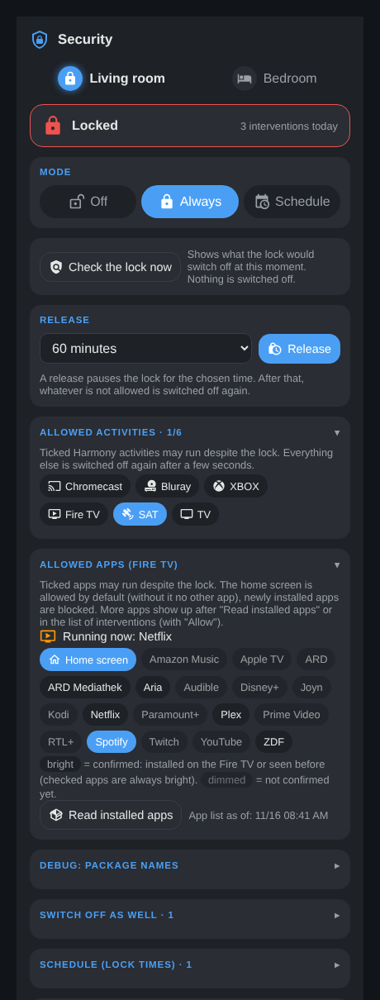
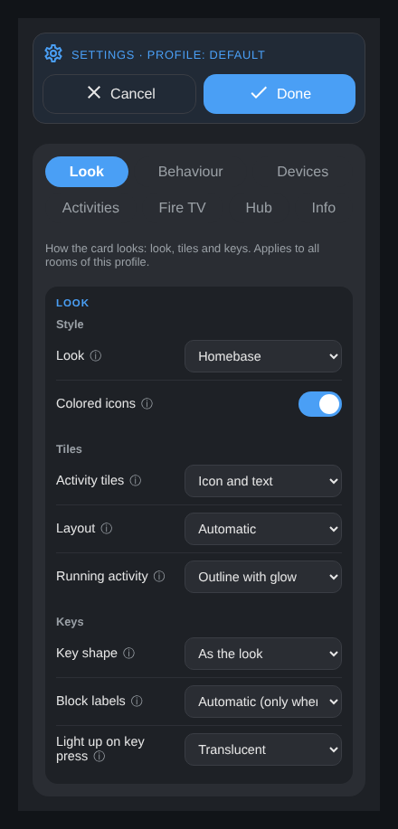
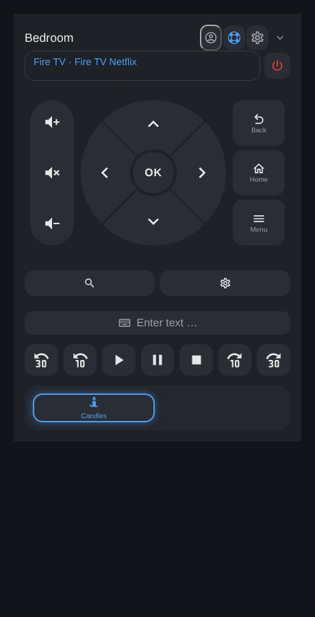
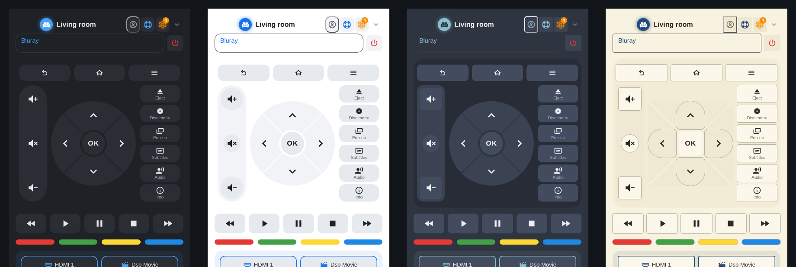
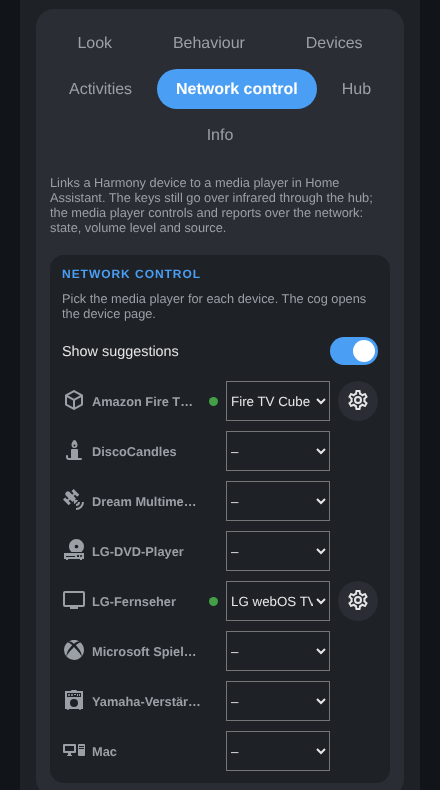
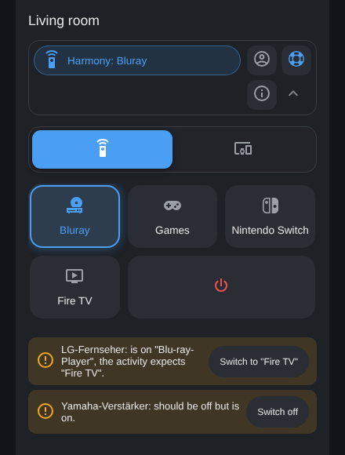
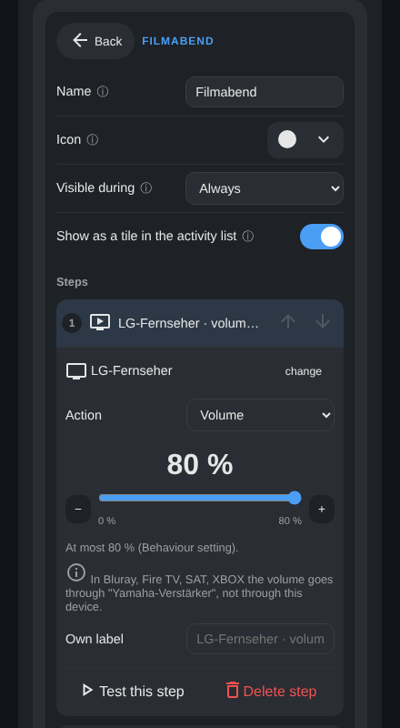
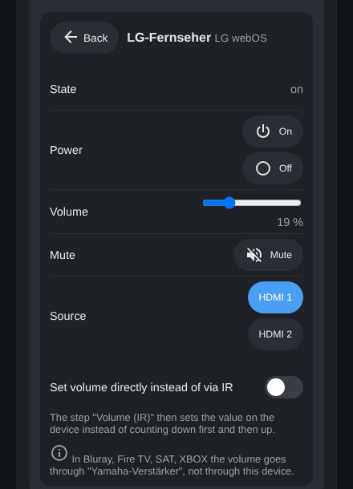

# Harmony Deck

[English](README.md) · [Русский](README.ru.md)

**Eine vollständige Fernbedienung für Logitech-Harmony-Hubs in Home Assistant, mit Fire-TV-Direktsteuerung und Kindersperre. Ohne YAML.**

Harmony Deck ist eine eigene Integration mit zwei Dashboard-Karten. Sie liest die Konfiguration deiner Harmony-Hubs (Aktivitäten, Geräte, jeden Befehl) und macht daraus eine Touch-Fernbedienung, die sich wie eine echte bedienen lässt: Aktivitäten als Kacheln, die richtigen Tasten für die laufende Aktivität, eine Fernbedienung pro Gerät und eine Sperre, die Kinder von nicht erlaubten Aktivitäten und Apps fernhält.

<p align="center">
  
  
  
</p>

> Kein Produkt von Logitech oder Amazon und nicht von ihnen unterstützt. „Harmony" und „Fire TV" sind Marken ihrer Inhaber.

## Warum Harmony Deck

- **Keine Konfiguration.** Aktivitäten, Geräte und alle Befehle kommen vom Hub. Welches Gerät in welcher Aktivität Lautstärke, Steuerkreuz oder Kanäle übernimmt, liest die Integration ebenfalls aus dem Hub. Andere Harmony-Karten verlangen dafür YAML.
- **Alles in der Karte.** Looks, Symbole, Favoriten, Verknüpfungen, Fire TV und Aktionen stellst du in einem Editor in der Karte ein. Gespeichert wird in Home Assistant, jedes Handy und Tablet zeigt dieselbe Fernbedienung.
- **Harmony und Fire TV in einer Fernbedienung.** Mit der Android-TV-Integration (ADB) bekommt der Fire TV Apps, Texteingabe und die Tasten, die der Hub nicht kennt, direkt in der Harmony-Aktivität.
- **Eine echte Kindersperre.** Pro Hub: erlaubte Aktivitäten und Fire-TV-Apps, Zeitplan, zeitliche Freigabe und Liste der Eingriffe. Die Integration setzt sie im Hintergrund durch, auch ohne offenes Dashboard.
- **Hilfe, wenn eine Aktivität nicht richtig startet.** Der Rettungsring zeigt die nötigen Geräte und Eingänge, mit einem Tipp pro Gerät zum Beheben, und führt zur Fernbedienung jedes Geräts.
- **Mehrere Räume.** Jeder Hub ist ein Reiter mit seinem Zustand auf einen Blick.
- **Netzwerksteuerung zusätzlich zu Infrarot.** Harmony-Gerät mit seinem Mediaplayer in Home Assistant verbinden: Harmony Deck liest, ob es wirklich an und auf dem richtigen Eingang ist, setzt die Lautstärke genau und bietet eine Korrektur per Tipp an, wenn eine Aktivität nicht richtig gestartet ist.

## Funktionen

| | |
|---|---|
| **Aktivitäten** | Kacheln mit Symbolen, laufende hervorgehoben, Halten zum Ausschalten, optional Halten zum Wechseln |
| **Fernbedienung** | Lautstärke, Steuerkreuz, Kanal, Wiedergabe, Farbtasten, Ziffern, jeweils an das richtige Gerät der Aktivität |
| **Geräte** | Eine Fernbedienung pro Gerät, Tasten in Gruppen (Eingänge, Ton, Menüs …), Tastatur für PC/Mac |
| **Favoriten** | Pro Gerät und pro Aktivität; Tasten, die du nie brauchst, lassen sich pro Gerät ausblenden |
| **Aktionen** | Eigene Tasten und Sequenzen aus Harmony-Tasten, Pausen und Home-Assistant-Aktionen, mit Bedingungen (Warten bis, Wenn), Werten (Helligkeit, Farbe, Lautstärke, Quelle …), Lautstärke für Infrarot-Geräte, Netzwerk-Befehlen, Schrittliste, Fortschritt und Abbruch, Favoriten pro Aktion, als Taste oder Kachel; jede Aktion ist auch eine Home-Assistant-Taste |
| **Netzwerksteuerung** | Harmony-Gerät mit seinem Mediaplayer (TV, Receiver) verbinden: Zustand, genaue Lautstärke und Quelle übers Netzwerk, erkannte Plattform mit ihren Eigenheiten, Soll/Ist-Prüfung mit Korrektur per Tipp, vorsichtige Vorschläge, abschaltbar |
| **Fire TV** | Apps, Wiedergabe/Pause, Standby, Texteingabe und Zusatztasten per ADB; beim Fire TV Cube Lautstärke über den Infrarot-Sender |
| **Sperre** | Aus / Immer / Zeitplan, zeitliche Freigabe, erlaubte Aktivitäten und Apps, Geräte, die mit dem Fire TV ausgehen, letzte 100 Eingriffe |
| **Looks** | 11 Looks, Kachel- und Tastenstile, farbige Symbole, hell und dunkel |
| **Profile** | Unterschiedliche Einstellungen für Personen oder Tablets |
| **Entitäten** | Aktivitäten, Geräte und Aktionen pro Hub als Liste, eine Taste pro Aktion, ein Gerät pro verbundenem Netzwerkgerät, Abweichungen pro Hub, Sperr-Entitäten, Reparaturhinweise und Diagnose |
| **Sprachen** | Deutsch, Englisch, Russisch; weitere als eine JSON-Datei |

## Im Vergleich

| | Harmony Deck | Andere Harmony-Karten | Universal Remote Card | HA‑Firemote |
|---|---|---|---|---|
| Aktivitäten und Befehle aus dem Hub | ja | meist YAML | nein | nein |
| Visueller Editor | ja | meist nein | ja | teilweise |
| Harmony und Fire TV in einer Fernbedienung | ja | nein | nein | nur Fire TV |
| Kindersperre durch die Integration | ja | nein | nein | nein |
| Mehrere Hubs als Reiter | ja | selten | nein | nein |
| Sequenzen (Tasten, Pausen, HA-Aktionen, Bedingungen) im visuellen Editor | ja | nein | einzelne Aktionen, längere Abläufe über Skripte | nein |
| Prüft, ob Geräte an und auf dem richtigen Eingang sind, mit Korrektur | ja (verbundene Mediaplayer) | nein | nein | nein |
| Home-Assistant-Entitäten: Taste pro Aktion, Listen pro Hub | ja | nein | nein | nein |

Die Universal Remote Card unterstützt viel mehr Plattformen und ist sehr frei gestaltbar, HA‑Firemote hat mehr Fire-TV-Looks. Harmony Deck konzentriert sich auf Harmony-Haushalte und nimmt dir die Einrichtung ab.

## Voraussetzungen und Kompatibilität

- Home Assistant **2025.1** oder neuer mit eingerichteter Integration **Logitech Harmony Hub**.
- Optional für Fire TV: die Integration **Android TV** (ADB), am Fire TV ADB-Debugging eingeschaltet.

**Bisher getestet:** ein Haushalt mit zwei Harmony Hubs und einem **Fire TV Cube (3. Generation)**. Andere Fire-TV-Modelle (Sticks, Fernseher mit Fire OS) sollten bei Apps und Tasten funktionieren, Einzelheiten wie die Infrarot-Lautstärke oder Paketnamen können abweichen. Ohne Fire TV funktioniert alles rund um Harmony, die Fire-TV-Teile bleiben einfach aus. Rückmeldungen von anderen Systemen sind sehr willkommen (Issues).

## Installation

### HACS

1. HACS → ⋮ → **Benutzerdefinierte Repositories** → `https://github.com/pcipci/harmony-deck` hinzufügen, Typ **Integration**.
2. **Harmony Deck** installieren, Home Assistant neu starten.
3. Einstellungen → Geräte & Dienste → **Integration hinzufügen** → **Harmony Deck**.

### Manuell

1. `custom_components/harmony_deck/` nach `/config/custom_components/` kopieren.
2. Home Assistant neu starten und die Integration wie oben hinzufügen.

Die Karten liefert die Integration selbst aus. Nichts muss nach `www` kopiert oder als Dashboard-Ressource eingetragen werden.

## Schnellstart

1. Karte zu einem Dashboard hinzufügen:
   ```yaml
   type: custom:harmony-deck-card
   ```
   Alle Hubs erscheinen als Reiter. Eine Aktivität antippen startet sie.
2. In der Karte **ⓘ** antippen, dann **Einstellungen**, **Favoriten** oder **Aktionen**. Jeder Reiter beginnt mit einer kurzen Erklärung.
3. Fire TV (optional): Einstellungen → **Netzwerksteuerung** → den `media_player` der Android-TV-Integration neben dem Fire TV wählen, das Zahnrad antippen, dann **Verbindung testen**.
4. Sperre (optional): die Sicherheitskarte auf eine Seite nur für Erwachsene legen:
   ```yaml
   type: custom:harmony-deck-security
   ```
   Modus wählen, erlaubte Aktivitäten und Apps anhaken, optional einen Zeitplan anlegen.

Die ausführliche Anleitung steht im [Handbuch](docs/HANDBUCH.md) (englisch: [Manual](docs/MANUAL.md)).

<p align="center">
  
  
  
</p>

## Aktionen und Netzwerksteuerung

**Aktionen** sind eigene Tasten: ein Schritt („Kerzen umschalten“) oder eine Sequenz aus Harmony-Tasten, Pausen, Home-Assistant-Aktionen, „Warten bis“ und „Wenn“. Sie laufen in der Integration und werden auch bei geschlossener Seite fertig. Jede Aktion ist zusätzlich eine **Taste** (button-Entität) am Gerät des Hubs (Drücken = Start; abgelehnt, solange eine andere Aktion läuft), der Sensor **Aktionen** listet sie auf.

**Netzwerksteuerung** verbindet ein Harmony-Gerät mit seinem Mediaplayer in Home Assistant. Die Tasten gehen weiter per Infrarot; der Player ergänzt, was Infrarot nicht kann: ist er wirklich an, welcher Eingang, welche Lautstärke genau. Steht ein Gerät nach dem Aktivitätsstart falsch, bietet ein Hinweis unter dem Status die Korrektur an. Jedes verbundene Gerät bekommt ein eigenes Gerät in Home Assistant („LG TV (Netzwerk)“) mit Plattform, Fähigkeiten und Zustand; ein verbundener Fire TV ist dasselbe Gerät und trägt den Sensor „ADB erreichbar“. Ein Zahnrad neben jedem Gerät öffnet seine Seite: was der Player kann als Zeilen mit Knöpfen (Ein/Aus, Lautstärke, Stumm, Quellen) oder beim Fire TV seine Apps, Texteingabe und Tasten.

<p align="center">
  
  
  
  
</p>

Vorschläge sind bewusst vorsichtig: Ein Player wird nur vorgeschlagen, wenn Geräteart, Modell oder ein Namenswort passen, nie wegen des Herstellers oder des Raums allein; reine Abspielziele (AirPlay, DLNA, Musikserver) werden nicht angeboten. Vorschläge lassen sich für alle Geräte oder pro Gerät abschalten.

## Die Sperre

Pro Hub legt die Integration **Sperre** (Schalter), **Sperr-Modus** (aus, immer, Zeitplan), **Freigabedauer**, **Freigeben** (Taste), **Sperre wirksam** (Binärsensor, erlaubte Aktivitäten als Attribut), **Freigegeben bis**, **Letzter Eingriff**, **Eingriffe heute** und ein Ereignis **Eingriff** (mit dem Namen des Ausgeschalteten, für Benachrichtigungen) an. Alle lassen sich in Automationen nutzen.

Solange die Sperre wirkt:

- Eine nicht erlaubte Aktivität zeigt in der Karte ein Schloss und wird nach 3 Sekunden ausgeschaltet, falls sie anders gestartet wird.
- Eine nicht erlaubte Fire-TV-App bekommt per ADB den Standby-Befehl. Ausgewählte Geräte (zum Beispiel der Fernseher) gehen mit aus.
- Der Fire-TV-Startbildschirm ist standardmäßig erlaubt. Ohne ihn lassen sich keine anderen Apps erlauben.

Im Modus *Zeitplan* sind die Zeitfenster Sperrzeiten (auch über Mitternacht). Nur Administratoren können die Sperre ändern.

Die Sperre ist eine Hilfe im Haushalt, kein Sicherheitsprodukt: Ein Administrator kann sie abschalten, und Geräte reagieren in den wenigen Sekunden bis zum Eingriff weiter auf ihre eigenen Fernbedienungen.

## Kartenoptionen (YAML)

Alles lässt sich auch in den Editoren einstellen. YAML-Optionen haben Vorrang vor den in Home Assistant gespeicherten Einstellungen. Die Liste der Optionen steht im [englischen README](README.md#card-options-yaml).

## Datenschutz

Alles läuft lokal in Home Assistant. Harmony Deck spricht mit den Hubs nur über die Harmony-Integration und mit dem Fire TV nur über die Android-TV-Integration. Es wird nichts ins Internet gesendet.

## Sprachen

Die Texte sind JSON-Dateien in `custom_components/harmony_deck/frontend/translations/`. Fehlende Schlüssel fallen auf Englisch zurück. Für eine neue Sprache `en.json` kopieren, die Werte übersetzen und einen Pull Request stellen.

## Lizenz

MIT, siehe [LICENSE](LICENSE). Änderungen: [CHANGELOG.md](CHANGELOG.md).
