# Harmony Deck

[Deutsch](README.de.md) · [Русский](README.ru.md)

**A complete remote for Logitech Harmony hubs in Home Assistant, with Fire TV direct control and a parental lock. No YAML needed.**

Harmony Deck is a custom integration plus two dashboard cards. It reads the configuration of your Harmony hubs (activities, devices, every command) and turns it into a touch remote that works like a real one: activities as tiles, the right keys for the running activity, a remote per device, and a lock that keeps children out of activities and apps you do not allow.

<p align="center">
  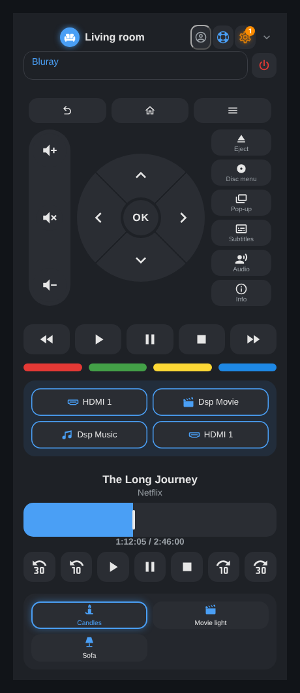
  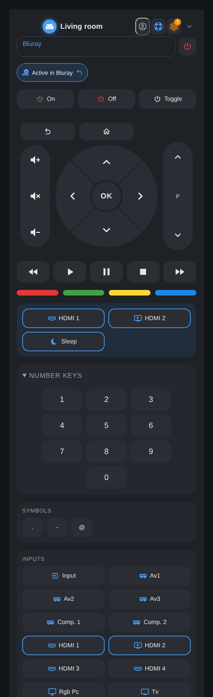
  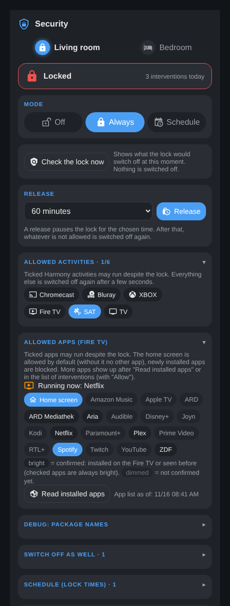
</p>

> Not affiliated with or endorsed by Logitech or Amazon. "Harmony" and "Fire TV" are trademarks of their owners.

## Why Harmony Deck

- **No configuration.** Activities, devices and all their commands come from the hub. Which device handles volume, the D‑pad or channels in each activity is read from the hub too. Other Harmony cards ask you to write this in YAML.
- **Everything in the card.** Looks, icons, favourites, links, Fire TV and actions are set in a visual editor inside the card and stored in Home Assistant, so every phone and tablet shows the same remote.
- **Harmony and Fire TV in one remote.** With the Android TV (ADB) integration the Fire TV gets apps, text input and the keys the hub does not know, right inside the Harmony activity.
- **A real parental lock.** Per hub: allowed activities and Fire TV apps, schedules, timed release and a list of interventions. The integration enforces it in the background, also when no dashboard is open.
- **Help when an activity does not start right.** The life ring shows the devices the activity needs and their inputs, with one tap per device to fix it, and leads to the remote of each device.
- **Several rooms.** Every hub is a tab with its state at a glance.
- **Network control on top of infrared.** Link a Harmony device to its Home Assistant media player: Harmony Deck reads whether it is really on and on the right input, sets an exact volume, and offers a one-tap fix when an activity did not start right.

## Features

| | |
|---|---|
| **Activities** | Tiles with icons, the running one highlighted, hold to switch off, optional hold to switch between activities |
| **Remote** | Volume, D‑pad, channel, transport, colour keys, number pad, each sent to the right device of the activity |
| **Devices** | One remote per device, keys grouped (inputs, sound, menus …), keyboard for PC/Mac devices |
| **Favourites** | Per device and per activity; keys you never use can be hidden per device |
| **Actions** | Own buttons and sequences of Harmony keys, pauses and Home Assistant actions, with conditions (wait until, if), values (brightness, colour, volume, source …), volume for infrared devices, network commands, step list, progress and stop, favorites per action, as a button or a tile; every action is also a Home Assistant button |
| **Network control** | Link a Harmony device to its media player (TV, receiver): state, exact volume (a slider instead of +/- in the remote) and source over the network, detected platform with its peculiarities, target vs. actual check with a one-tap fix, careful suggestions you can switch off |
| **Fire TV** | Apps, play/pause, standby, text input and extra keys over ADB; on a Fire TV Cube the volume can go through its infrared sender |
| **Lock** | Off / always / schedule, timed release, allowed activities and apps, devices switched off with the Fire TV, last 100 interventions |
| **Looks** | 15 skins incl. the effect skins Terminal, Tube radio, Thermal (heat vision, segment letters), Nixie (number tubes, toggle switches) and Nostromo (amber ship computer); an own skin per room; tile and key styles, coloured icons, light and dark |
| **Hints** | One gear in the tab row: it takes the colour of the most serious hint (hub not reachable, player differs from the activity …), pulses until seen and shows the count; its window lists the hints with their action above the settings; its Info entry opens an Info area with the hubs, the linked network devices (platform, address, state, capabilities) as a table and which keys of the running activity go direct or over Harmony; gear, help and profile share one window |
| **Profiles** | Different settings for different people or tablets |
| **Entities** | Activities, devices and actions of each hub as lists, a button per action, a device per linked network device, differences per hub, lock entities, repair hints and diagnostics |
| **Languages** | English, German, Russian; more as one JSON file |

## Compared with other cards

| | Harmony Deck | Other Harmony cards | Universal Remote Card | HA‑Firemote |
|---|---|---|---|---|
| Activities and commands read from the hub | yes | mostly YAML | no | no |
| Visual editor | yes | mostly no | yes | partly |
| Harmony and Fire TV in one remote | yes | no | no | Fire TV only |
| Parental lock enforced by the integration | yes | no | no | no |
| Several hubs as tabs | yes | rarely | no | no |
| Sequences (keys, pauses, HA actions, conditions) in a visual editor | yes | no | single actions, longer flows via scripts | no |
| Checks that devices are on and on the right input, with a fix | yes (linked media players) | no | no | no |
| Home Assistant entities: a button per action, lists per hub | yes | no | no | no |

The Universal Remote Card supports many more platforms and is very flexible; HA‑Firemote has more Fire TV looks. Harmony Deck focuses on Harmony households and does the setup for you. (Compared with the public READMEs of these projects, November 2026.)

## Requirements and compatibility

- Home Assistant **2025.1** or newer with the core **Logitech Harmony Hub** integration set up.
- Optional for Fire TV: the core **Android TV** integration (ADB), with ADB debugging switched on at the Fire TV.

**Tested so far:** a household with two Harmony Hubs and a **Fire TV Cube (3rd generation)**. Other Fire TV models (sticks, TVs with Fire OS) should work for apps and keys, but details such as the infrared volume or package names may differ. Without a Fire TV everything Harmony related works and the Fire TV parts simply stay off. Reports from other setups are very welcome (Issues).

## Installation

### HACS

1. HACS → ⋮ → **Custom repositories** → add `https://github.com/pcipci/harmony-deck`, type **Integration**.
2. Install **Harmony Deck** and restart Home Assistant.
3. Settings → Devices & services → **Add integration** → **Harmony Deck**.

### Manual

1. Copy `custom_components/harmony_deck/` to `/config/custom_components/`.
2. Restart Home Assistant and add the integration as above.

The cards are served by the integration. You do not need to copy files to `www` or add a dashboard resource.

## Quick start

1. Add a card to a dashboard:
   ```yaml
   type: custom:harmony-deck-card
   ```
   All hubs appear as tabs. Tap an activity to start it.
2. Tap **ⓘ** in the card and then **Settings**, **Favorites** or **Actions**. Every settings tab starts with a short explanation.
3. Fire TV (optional): Settings → **Network control** → choose the `media_player` of the Android TV integration next to the Fire TV, tap the cog, then **Test connection**.
4. Lock (optional): add the security card on a page only adults use:
   ```yaml
   type: custom:harmony-deck-security
   ```
   Choose the mode, tick the allowed activities and apps, optionally add a schedule.

The full guide is the [manual](docs/MANUAL.md) (German: [Handbuch](docs/HANDBUCH.md)).

<p align="center">
  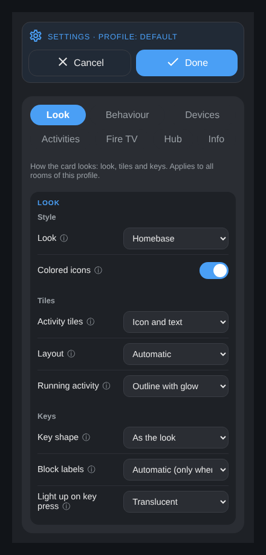
  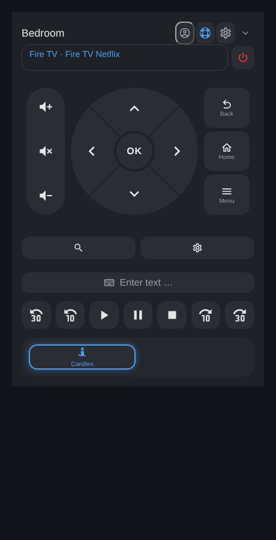
  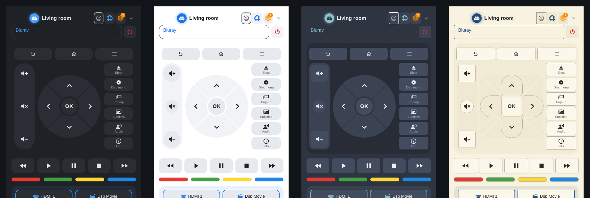
</p>

Two effect skins go further than colours: **Terminal** (green phosphor screen, scanlines, snow, a rolling bar and now and then a flicker; activities as list lines, the running one inverted) and **Tube radio** (wood and brass, every tile a pilot lamp (lit = running or selected), an amber magic eye that follows the volume, sunken brass buttons with a lamp behind, keys with a state as lit dark glass, faint lamp flicker, a dial with the room and the running activity, a rocker plate for Activities/Devices). Effects only lie over the card, animations stop with "reduce motion". 0.17 adds **Thermal** (heat vision with segment letters), **Nixie** (number tubes, brass toggle switches) and **Nostromo** (amber ship computer); since 0.18 each room can have its own skin.

<p align="center">
  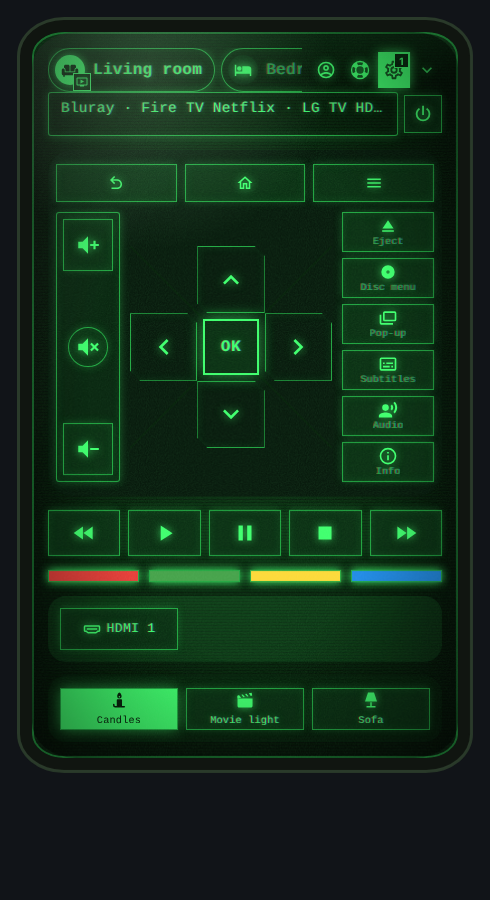
  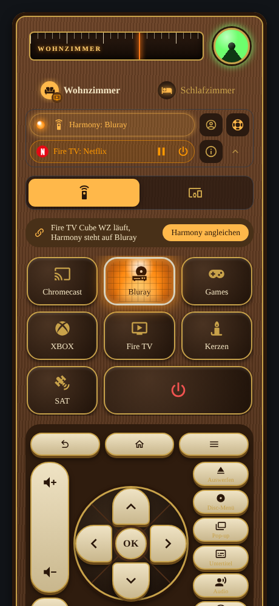
</p>

## Actions and network control

**Actions** are your own buttons: one step ("toggle the candles") or a sequence of Harmony keys, pauses, Home Assistant actions, "wait until" and "if". They run in the integration, so they finish when the page is closed. Every action is also a **button entity** on the hub's device (press = start; refused while another action runs), and the sensor **Actions** lists them.

**Network control** links a Harmony device to its Home Assistant media player. The keys keep going over infrared; the player adds what infrared cannot: is it really on, which input, the exact volume. When an activity left a device in the wrong state, a box under the status offers the fix. Each linked device gets its own device in Home Assistant ("LG TV (Network)") with platform, capabilities and state; a linked Fire TV is the same device and carries its "ADB reachable" sensor. A cog next to each device opens its page: what the player can do as rows with buttons (on/off, volume, mute, sources), or for the Fire TV its apps, text input and keys.

<p align="center">
  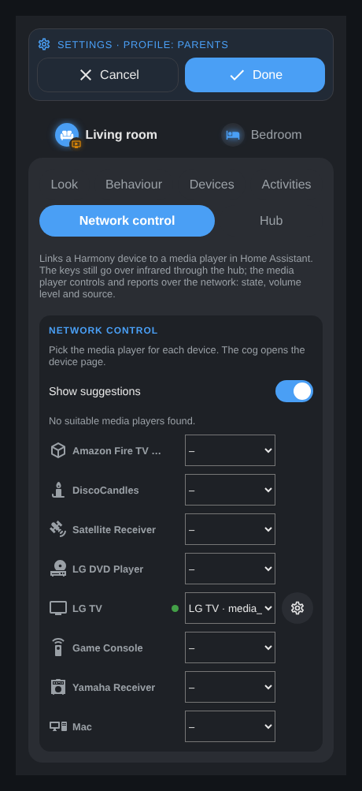
  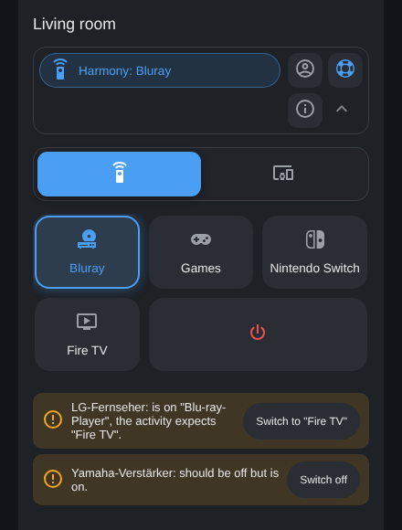
  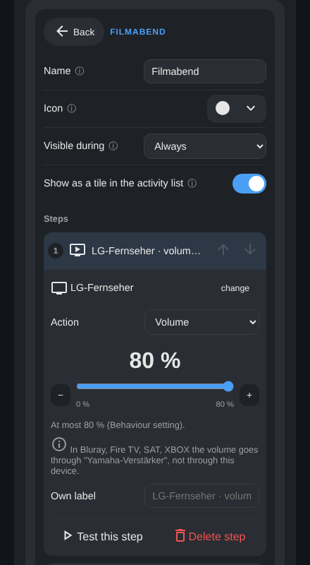
  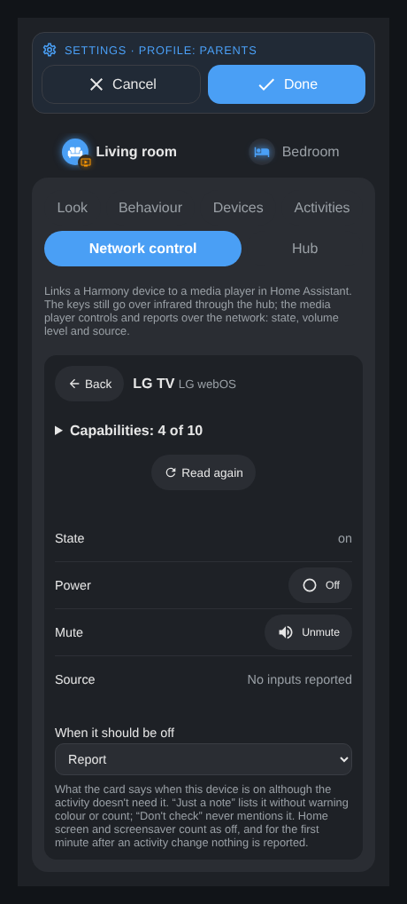
</p>

Suggestions in the tab are deliberately careful: a player is only suggested when kind, model or a name word fit, never for the maker or the room alone, and pure playback targets (AirPlay, DLNA, music servers) are not offered. Suggestions can be switched off for all devices or per device.

## The lock

Per hub the integration creates **Lock** (switch), **Lock mode** (off, always, schedule), **Release duration**, **Release** (button), **Lock active** (binary sensor, allowed activities as attribute), **Released until**, **Last intervention**, **Interventions today** and an **Intervention** event (fires with the name of what was switched off, for notifications). You can use them in automations.

While the lock is active:

- An activity that is not allowed shows a lock in the card and is switched off after 3 seconds if it is started some other way.
- A Fire TV app that is not allowed gets a standby command over ADB. Devices you chose (for example the TV) are switched off with it.
- The Fire TV home screen is allowed by default. Without it no other app can be allowed.

In the mode *schedule* the time windows are lock times (a window may run over midnight). Only administrators can change the lock.

The lock is a household aid, not a security product: an administrator can switch it off, and devices still react to their own remotes for the few seconds until the integration steps in.

## Card options (YAML)

Everything can also be set in the visual editors. YAML options win over the settings stored in Home Assistant.

<details><summary>Main card</summary>

| Option | Meaning |
|---|---|
| `entity` | one hub (`remote.…`), empty = all hubs as tabs |
| `skin` | `homebase`, `dark`, `light`, `pebble`, `paper`, `clay`, `glass`, `nord`, `catppuccin`, `synthwave`, `terminal`, `radio`, `thermal`, `nixie`, `nostromo` |
| `language` | `de`, `en`, `ru` (default: language of Home Assistant) |
| `columns` | tiles per row (default 3) |
| `tile_style` | `icon_text`, `icon`, `text` |
| `compact`, `compact_dpad` | compact variant |
| `hide` | activities to hide |
| `colored_icons`, `vibrate`, `help_names` | look and feel |
| `hold_switch` | switching from a running activity needs a long press |
| `security_path` | dashboard path; a tap on the lock symbol opens it |
| `keyboard_control`, `physical_keyboard`, `keyboard_layout`, `keyboard_os`, `hold_secs` | keyboard |
| `direct` | Fire TV: `{remote.xyz: {entity, device}}` |
| `links` | `{remote.xyz: [{activity, entity, lockActivities, lockKeys}]}` |
| `key_icons` | `{"Command": "mdi:…", "Device/Command": "mdi:…"}` |
| `profile` | fix a profile for this card |
| `skin_vars`, `title` | advanced |
</details>

<details><summary>Security card</summary>

| Option | Meaning |
|---|---|
| `entity` | one hub, empty = all hubs |
| `title`, `skin`, `skin_vars`, `language` | as in the main card |
| `log_rows` | rows of the intervention list before "show all" (default 12) |
</details>

## Privacy

Everything runs locally in Home Assistant. Harmony Deck talks to the hubs only through the Harmony integration and to the Fire TV only through the Android TV integration. It sends nothing to the internet.

## Languages

The texts are JSON files in `custom_components/harmony_deck/frontend/translations/`. Missing keys fall back to English. To add a language, copy `en.json`, translate the values and open a pull request (details in the README of that folder).

## Development

- Integration: `custom_components/harmony_deck/` (Python).
- Cards: sources in `card/src`, bundled with esbuild into `custom_components/harmony_deck/frontend/harmony-deck-card.js` (see [card/README.md](card/README.md)).
- Tests: `pip install -r requirements_test.txt`, then `python -m pytest tests` (they run inside a real Home Assistant core); cards: `cd card && npm ci && npm run check`.

Changes: [CHANGELOG.md](CHANGELOG.md).

## License

MIT, see [LICENSE](LICENSE).
