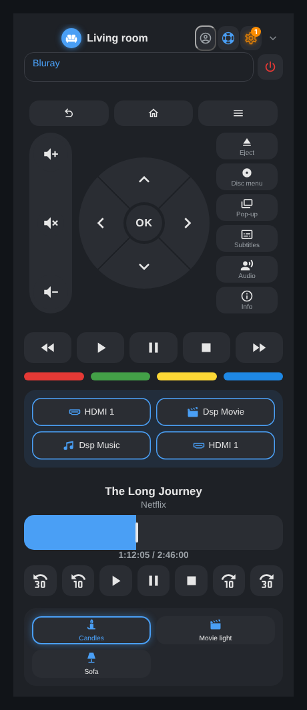
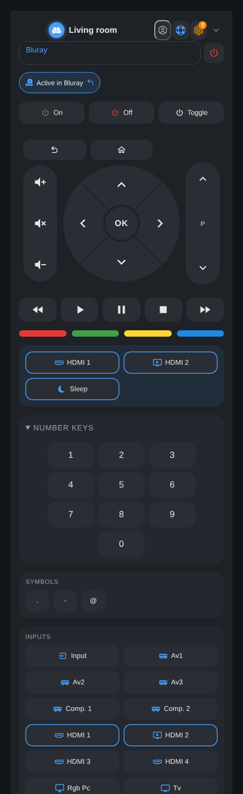
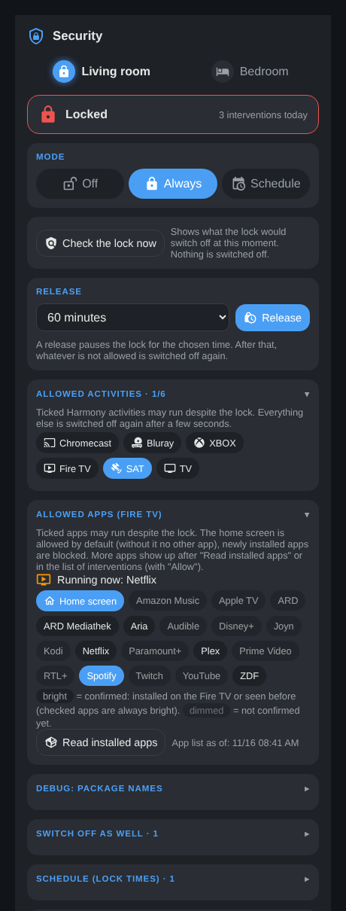

# Harmony Deck

[English](README.md) · [Deutsch](README.de.md)

**Полноценный пульт для хабов Logitech Harmony в Home Assistant, с прямым управлением Fire TV и родительской блокировкой. Без YAML.**

Harmony Deck — это пользовательская интеграция с двумя карточками для панелей. Она читает конфигурацию хабов Harmony (активности, устройства, все команды) и превращает её в сенсорный пульт: активности в виде плиток, нужные кнопки для запущенной активности, пульт для каждого устройства и блокировка, которая не пускает детей в неразрешённые активности и приложения.

<p align="center">
  
  
  
</p>

> Не является продуктом Logitech или Amazon и не поддерживается ими. «Harmony» и «Fire TV» — товарные знаки их владельцев.

## Почему Harmony Deck

- **Без настройки.** Активности, устройства и все команды берутся из хаба, как и то, какое устройство отвечает за громкость, крестовину и каналы в каждой активности. Другим карточкам для Harmony для этого нужен YAML.
- **Всё в карточке.** Стили, значки, избранное, связи, Fire TV и действия настраиваются в редакторе прямо в карточке и хранятся в Home Assistant — на всех телефонах и планшетах один и тот же пульт.
- **Harmony и Fire TV в одном пульте.** Через интеграцию Android TV (ADB) Fire TV получает приложения, ввод текста и кнопки, которых нет в хабе, прямо внутри активности Harmony.
- **Настоящая родительская блокировка.** Для каждого хаба: разрешённые активности и приложения Fire TV, расписание, временное разблокирование и список вмешательств. Интеграция следит за ней в фоне, даже когда панель не открыта.
- **Помощь, если активность запустилась не так.** Спасательный круг показывает нужные устройства и входы, одно касание на устройство, и ведёт к пульту каждого устройства.
- **Несколько комнат.** Каждый хаб — вкладка с состоянием с первого взгляда.

## Возможности

| | |
|---|---|
| **Активности** | Плитки со значками, запущенная выделена, удержание для выключения, по желанию удержание для смены |
| **Пульт** | Громкость, крестовина, каналы, воспроизведение, цветные и цифровые кнопки — каждая на нужное устройство активности |
| **Устройства** | Пульт для каждого устройства, кнопки по группам, клавиатура для ПК/Mac |
| **Избранное** | Для устройств и для активностей; ненужные кнопки можно скрыть для каждого устройства |
| **Действия** | Свои кнопки и последовательности из кнопок Harmony, пауз и действий Home Assistant, с условиями (ждать, если), значениями, громкостью для ИК-устройств и сетевыми командами; каждое действие — также кнопка в Home Assistant |
| **Сетевое управление** | Связать устройство Harmony с его медиаплеером (ТВ, ресивер): состояние, точная громкость (ползунок вместо +/- в пульте) и источник по сети, распознанная платформа, проверка «должно/есть» с исправлением одним нажатием, осторожные предложения (отключаемые) |
| **Fire TV** | Приложения, пауза, режим ожидания, ввод текста и доп. кнопки по ADB; на Fire TV Cube громкость через ИК-передатчик |
| **Блокировка** | Выкл / всегда / расписание, временное разблокирование, разрешённые активности и приложения, устройства, выключаемые вместе с Fire TV, последние 100 вмешательств |
| **Стили** | 11 стилей, светлая и тёмная тема |
| **Профили** | Разные настройки для разных людей или планшетов |
| **Объекты** | Активности, устройства и действия каждого хаба списком, кнопка для каждого действия, отдельное устройство для каждого сетевого устройства, расхождения по хабу, объекты блокировки, подсказки и диагностика |
| **Языки** | Русский, английский, немецкий; другие — одним файлом JSON |

## Требования и совместимость

- Home Assistant **2025.1** или новее с настроенной интеграцией **Logitech Harmony Hub**.
- По желанию для Fire TV: интеграция **Android TV** (ADB), на Fire TV включена отладка ADB.

**Проверено:** дом с двумя хабами Harmony и **Fire TV Cube (3-го поколения)**. Другие модели Fire TV должны работать с приложениями и кнопками, но ИК-громкость или имена пакетов могут отличаться. Без Fire TV всё, что связано с Harmony, работает, части Fire TV просто отключены. Отзывы с других систем приветствуются (Issues).

## Установка

### HACS

1. HACS → ⋮ → **Пользовательские репозитории** → `https://github.com/pcipci/harmony-deck`, тип **Integration**.
2. Установить **Harmony Deck**, перезапустить Home Assistant.
3. Настройки → Устройства и службы → **Добавить интеграцию** → **Harmony Deck**.

### Вручную

1. Скопировать `custom_components/harmony_deck/` в `/config/custom_components/`.
2. Перезапустить Home Assistant и добавить интеграцию.

Карточки поставляет сама интеграция, копировать в `www` и добавлять ресурс не нужно.

## Быстрый старт

```yaml
type: custom:harmony-deck-card
```

Все хабы появятся как вкладки. **ⓘ** открывает настройки, избранное и действия. Для блокировки добавьте на страницу только для взрослых:

```yaml
type: custom:harmony-deck-security
```

Подробное руководство: [Manual](docs/MANUAL.md) (англ.), [Handbuch](docs/HANDBUCH.md) (нем.). Параметры YAML: [README на английском](README.md#card-options-yaml).

## Конфиденциальность

Всё работает локально в Home Assistant, в интернет ничего не отправляется.

## Лицензия

MIT, см. [LICENSE](LICENSE). Изменения: [CHANGELOG.md](CHANGELOG.md).
